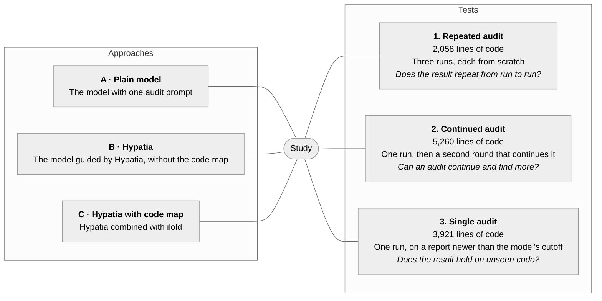
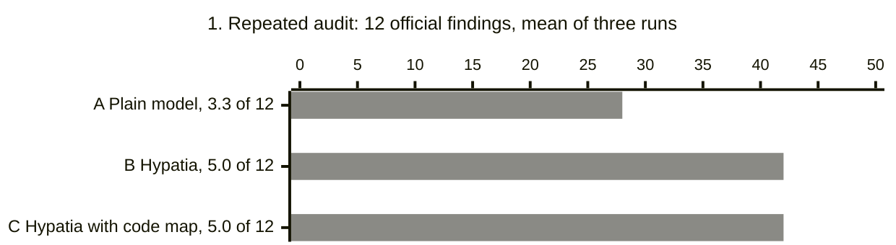
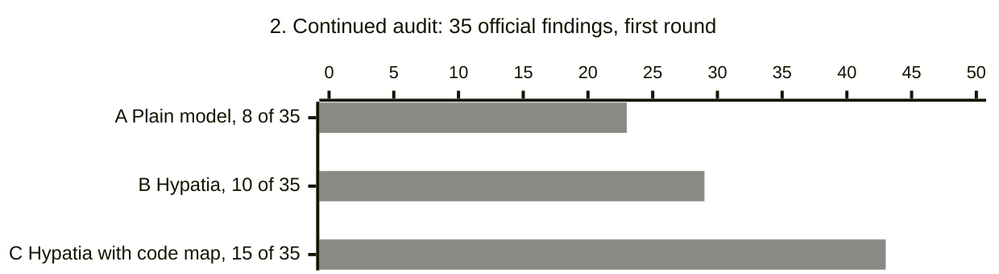
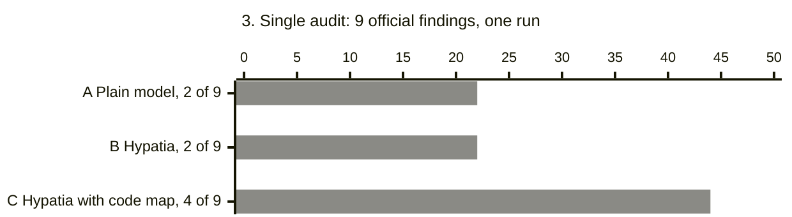

# Hypatia benchmark

Data and method of the study *Can a structured process and a code map improve AI smart-contract audits? An evaluation of Hypatia on three professionally audited projects*.

| | |
|---|---|
| Article | [Read the article](https://scab24.github.io/blog/hypatia-benchmark.html) |
| Paper | [PDF on the web](https://scab24.github.io/reports/hypatia-benchmark.pdf) · [PDF in this repository](paper/hypatia-benchmark.pdf) |
| Hypatia | [How Hypatia works](https://scab24.github.io/tools/hypatia.html) |
| ilold | [scab24/ilold-evm](https://github.com/scab24/ilold-evm), the open-source path analyser that builds the code map |
| Author | [scab24.github.io](https://scab24.github.io) |

## Study

The same AI model audits the same Solidity code in three ways, on three projects with a public audit report. The reference is the list of vulnerabilities that each project's auditors reported.



The code map is built by [ilold](https://github.com/scab24/ilold-evm), an open-source path analyser for Solidity.

## Result

Official Critical, High and Medium findings found by each approach, as a share in percent of those the auditors reported. Each label gives the count.







Findings were scored by running their tests and by reading. The paper gives the nine experiments and the limits of the study.

## Contents

| Path | Content |
|---|---|
| [`paper/`](paper/) | The paper as PDF and as Markdown, its figures, and the scripts that draw the figures and build the PDF and the HTML |
| [`results/runs.json`](results/runs.json) | One record per run and approach: findings reported, distinct and valid, official findings matched, minutes and output tokens |
| [`scoring/official-matches.json`](scoring/official-matches.json) | The official findings each approach matched in each run, strictly and leniently |
| [`ground-truth/`](ground-truth/) | The official findings of each project, with the audited commit, the fixed commit and the link to the public report |
| [`method/prompt-plain-model.md`](method/prompt-plain-model.md) | The prompt of approach A |
| [`method/reproducing-approach-a.md`](method/reproducing-approach-a.md) | The steps to run approach A again |
| [`method/judge.py`](method/judge.py) | The judge, which runs the test of a finding on the audited code and on the fixed code |
| [`method/metrics.md`](method/metrics.md) | The plan of what to measure, written before the first counted run |

## Tracing a number

1. A count in the paper, for example 15 of 35 on GTE for approach C, is in `results/runs.json`.
2. `scoring/official-matches.json` lists the official findings behind it.
3. `ground-truth/gte.json` describes each of them and links to the public report.

## Rebuilding the figures and the paper

```
cd paper
python3 figures/make_charts.py
python3 figures/make_flow_variants.py
python3 figures/make_cover.py
python3 build_pdf.py
```

The numbers of the figures are the literals at the top of `figures/make_figures.py`. The PDF needs pandoc and pdflatex.

## Not included

- **Hypatia.** Its source is not public. The paper describes how it works. Approaches B and C cannot be rerun from this repository, and approach A can.
- **Session transcripts and workspaces.** They contain Hypatia's internal prompts.

## Licence

- The paper, the figures and the data are under [CC BY 4.0](LICENSE-CC-BY-4.0).
- The code, which is every `.py` file, is under the [MIT licence](LICENSE-MIT).

The official findings in `ground-truth/` belong to the auditors of each project. This repository lists their titles and links to the public reports.

## Author

Sergio Corrales Alonso-Barajas · [scab24.github.io](https://scab24.github.io) · git.seco@protonmail.com
