# Can a structured process and a code map improve AI smart-contract audits? An evaluation of Hypatia on three professionally audited projects

Sergio Corrales Alonso-Barajas

November 2026.

## Contents

1. Executive summary
2. Context
3. What was tested
4. Methodology
5. Experiments
   - 5.1 Experiment 1: findings found across three independent runs
   - 5.2 Experiment 2: findings found on a larger project
   - 5.3 Experiment 3: what the model recalls of a public report
   - 5.4 Experiment 4: the step where Hypatia lost each official finding it missed
   - 5.5 Experiment 5: new findings when an audit is continued
   - 5.6 Experiment 6: the second round after correcting Hypatia
   - 5.7 Experiment 7: findings found on a project the model had not seen
   - 5.8 Experiment 8: validity of findings outside the official reports
   - 5.9 Experiment 9: time and tokens per valid finding
6. Synthesis
7. Limitations
8. Conclusion
9. Reproducibility
10. Related work and references

## 1. Executive summary

Hypatia is a tool that guides an AI model through a security audit in phases, in place of a single prompt. It is not tied to one programming language. It is written by the author of this report and its source is not public.

This study evaluates it on EVM smart contracts, where it can be combined with [ilold](https://github.com/scab24/ilold-evm), an open-source path analyser for Solidity code by the same author. ilold gives Hypatia a map of the code: its functions, the calls between them and the data they read and write. Hypatia derives from that map a list of questions to investigate.

The study asks whether this combination finds more of the vulnerabilities that professional audits reported than the model alone, and whether it allows an audit to continue from where it stopped.

### The three approaches compared

The same model audits the same code in three ways.

| | Approach | What it is |
|---|---|---|
| A | Plain model | The model with one audit prompt |
| B | Hypatia | The model guided by Hypatia, without ilold. A general code-search tool is available |
| C | Hypatia with code map | Hypatia combined with ilold. The same code-search tool is available |

### Study design

The study has three tests. Each uses a different project and a different way of running the audit, and each answers one question. The three approaches are run in every test.

| Test | Procedure | Runs per approach | Project | Question |
|---|---|---|---|---|
| **1. Repeated audit** | Three runs, each from scratch | 3 independent runs | ONCHAINID, 2,058 lines | Does the result repeat from run to run? |
| **2. Continued audit** | One run, then a second round that continues it | 1 run and 1 continuation | GTE, 5,260 lines | Can an audit continue and find more? |
| **3. Single audit** | One run, on a report published after the model's knowledge cutoff | 1 run | Promis, 3,921 lines | Does the result hold on a project the model had not seen? |

The official audit report of each project is the reference in the three tests. Details are in [section 3](#sec-3) and [section 4](#sec-4).

### What is measured and why

| Parameter | Purpose | Section |
|---|---|---|
| Detection | How many officially reported vulnerabilities each approach finds | [5.1](#sec-5-1), [5.2](#sec-5-2), [5.7](#sec-5-7) |
| Repeatability | Whether the result holds from run to run | [5.1](#sec-5-1) |
| Role of the code map | What Hypatia adds to the model, and what the code map adds to Hypatia | [5.1](#sec-5-1), [5.2](#sec-5-2), [5.7](#sec-5-7) |
| Precision | How many reported findings are valid, and whether their severity is right | [5.2](#sec-5-2), [5.7](#sec-5-7), [5.8](#sec-5-8) |
| Memorisation | Whether the model could be reciting a report seen in training | [5.3](#sec-5-3) |
| Losses | At which step Hypatia loses the vulnerabilities it misses | [5.4](#sec-5-4) |
| Continuation | What each approach finds when asked to continue its own audit | [5.5](#sec-5-5) |
| Correction | Whether changing Hypatia on that evidence improves the result | [5.6](#sec-5-6) |
| Coverage | How many questions were decided and how many stayed open | [5.6](#sec-5-6), [5.7](#sec-5-7) |
| Findings beyond the reports | Whether findings outside the official reports are valid | [5.8](#sec-5-8) |
| Effort | The time and tokens each run and each finding takes | [5.9](#sec-5-9) |

### Main result

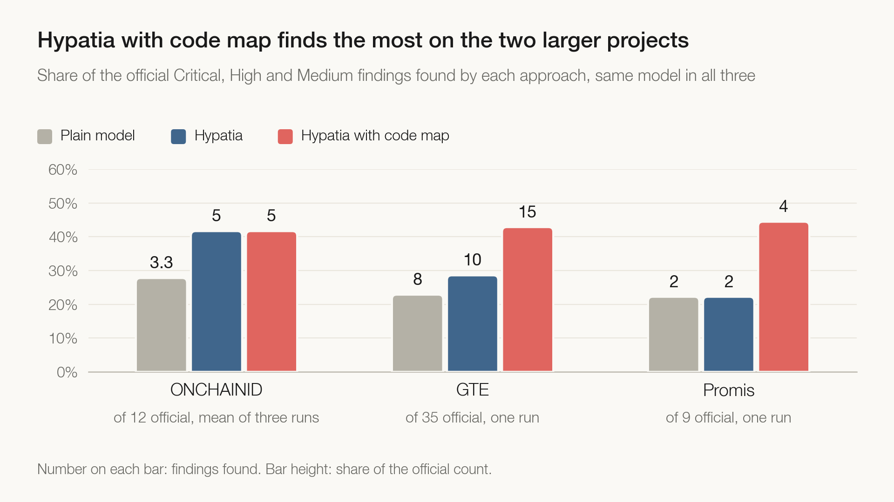

*Figure 1. Official Critical, High and Medium findings found by each approach. The number on each bar is the count found and the bar height is its share of the official count of the project (12, 35 and 9). ONCHAINID is the mean of three runs, GTE and Promis rest on one run per approach, and Low findings and Notes are left out because the Plain model was told not to report them.*

- On the two larger projects, Hypatia with code map finds the most official Critical, High and Medium findings.
- On the smallest project, both Hypatia approaches find more than the plain model, and the code map adds nothing.
- Asked to continue an audit, in one run on GTE, Hypatia with code map produced 13 new findings, two of them official and four rated doubtful. The other two approaches produced 2 each.

The full results are in [section 6](#sec-6). The limits of the study are in [section 7](#sec-7).

## 2. Context

### 2.1 The question

AI models can now find and exploit real vulnerabilities in smart contracts.

Several published evaluations run independent attempts on each task and count success if any attempt works. Examples are the best of 8 attempts in Anthropic's smart-contract evaluation and success in any of k attempts in Project Naptime.

This report takes as its working assumption that a manual audit proceeds differently:

- it builds a model of the system
- it lists what could go wrong
- it tests each hypothesis
- it records what was covered and what was not

No source is cited for this description. It is an assumption of the report, not a documented account of how professional audits work.

The question of this report is whether structuring a model's audit in this way changes the result, and which part of the structure makes the difference.

### 2.2 Why three approaches

Each comparison between two approaches answers one question.

| Comparison | What differs | What it shows |
|---|---|---|
| C against B | The code map, and nothing else | What the code map adds to Hypatia |
| B against A | Hypatia, and the instructions each one receives | What Hypatia adds to the plain model |

**C against B is a direct comparison.** Both are started with the same command and the same tools. One setting turns the code map on or off.

**B against A needs one precaution.** A was asked to report findings of Medium severity or higher, and B was not. To compare them fairly, this report counts Critical, High and Medium findings only.

### 2.3 What counts as a result

A reported finding is confirmed in two steps:

1. The approach writes a test that shows the problem on the audited code.
2. The same test fails once the official fix is applied.

This follows the criterion of Anthropic's smart-contract evaluation, where success is shown by execution and not by opinion.

When the test cannot be run against the fixed code or against a single official fix, the finding is compared with the official report by reading. Each experiment states how many of its matches were made by reading.

## 3. What was tested

### 3.1 Model and common settings

| Setting | Value |
|---|---|
| Model | Claude Opus 5.5 |
| Reasoning effort | Medium |
| Session | Non-interactive. No human took part during a session |
| Operator steps | An operator prepared and launched each run, prepared the second-round profile for the Hypatia approaches and resumed two interrupted runs |
| Limits stated to the model | A: told there is no time limit and no spending limit. B and C: an iteration limit in the launch command, nothing about time or spending |
| Network | Blocked for shell commands. Web tools disabled |
| Billing | Flat-rate subscription. Usage is reported as time and tokens |

The operator's environment record gives June 2026 as the model's knowledge cutoff. No vendor statement of that date is stored with the benchmark. This date decides which reports the model could have seen during training.

### 3.2 The three approaches

| | Approach | How the audit is started | Code map | Severity asked for | Stops when |
|---|---|---|---|---|---|
| A | Plain model | One prompt, adapted from the prompt of Anthropic's smart-contract evaluation | No | Medium or higher, as its prompt asks | The model decides it has finished |
| B | Hypatia | Hypatia's audit command | No | All severities, Hypatia's default | Hypatia's checks pass, or the iteration limit is reached |
| C | Hypatia with code map | The same command with the code map enabled | Yes | All severities, Hypatia's default | Hypatia's checks pass, or the iteration limit is reached |

Notes on the table:

- **Severity.** The difference in the severity asked for is the reason the headline comparison uses Critical, High and Medium findings.
- **Tools.** All three have the same tool list: a shell, file tools, text search, sub-agents, and the project's build and test tools. A static analyser is installed for all three, and A's prompt is the one that mentions it. A code-search tool (CodeGraph) is installed on the machine for all three. For B and C it is also connected as a tool. A never used it, B used it once in seven runs and C 28 times. It is not the code map of this report, which is ilold.
- **Integrations switched off.** In B and C, Hypatia's optional use of external findings databases and of earlier audits of the same project was disabled.
- **Iteration limit.** It was 100 in the runs with the first version of Hypatia and 40 in the runs with the corrected version (sections 5.6 and 9).
- **Stopping.** No B run reached its iteration limit. C reached it in the corrected GTE round and on Promis.

### 3.3 The projects audited

Each project has a public audit report and a known audited version of the code. The test each project is used for is in the [study design](#study-design).

| Project | Audited by | Size | Report published | Against the model's knowledge cutoff |
|---|---|---|---|---|
| ONCHAINID | OpenZeppelin, audit firm | 2,058 lines | September 2026 | After |
| GTE Perps and Launchpad | Code4rena, public audit contest | 5,260 lines | February 2026 | Before |
| Promis | yAudit, audit firm | 3,921 lines | July 2026 | After |

Official findings, and which of them are compared:

| Project | Official findings | Comparable basis | Reported separately |
|---|---|---|---|
| ONCHAINID | 39 | 12: 1 Critical, 2 High, 9 Medium | 27: 20 Low, 7 Notes |
| GTE | 35 | 35: 10 High, 25 Medium | None |
| Promis | 34 | 9: 5 High, 4 Medium | 14 Low |

- **GTE.** Its report was public before the cutoff, so a test for memorised answers is in section 5.3. The contest's lower-severity reports are not in the reference. GTE was also the project used to correct Hypatia, so its results after the correction are not independent evidence.
- **Promis.** Not used: one Medium (M-04) outside the audited files, 1 Gas and 9 Informational findings, which no approach matched. M-05 is partly outside the audited files and is counted among the four Mediums.
- **Size.** Lines exclude comments and blank lines. GTE's figure is the contest's own count. The count used for the other two projects gives 6,290 lines for GTE.

Terms used for the runs:

- **Run.** One audit by one approach.
- **Repetition.** An independent rerun of the same audit from scratch.
- **Round.** A first audit, or a second audit that continues it in the same workspace.

### 3.4 How Hypatia runs an audit

Hypatia takes the model through the same steps in every audit. Each step ends with a check, and the audit moves on only when the check passes.

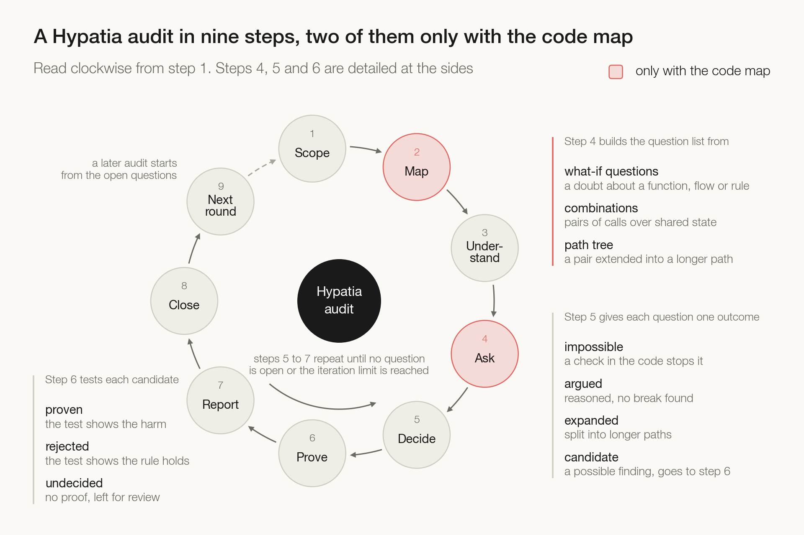

*Figure 2. The nine steps of a Hypatia audit, read clockwise from step 1, with steps 2 and 4 only when the code map is used. The lists give what step 4 builds the question list from, the outcome step 5 gives each question and the result of the test in step 6. Steps 5 to 7 repeat until no question is open or the iteration limit is reached, and a later audit starts from the open questions, which only the corrected version passes on (section 3.5).*

| Step | What Hypatia does | Check before moving on |
|---|---|---|
| 1. Scope | Fixes the files to audit | The scope is accepted |
| 2. Map | ilold lists the functions, the calls between them, the data they read and write, and the checks that can stop a call. Approach C only | The map covers the scope |
| 3. Understand | The model describes each function, then the flows, phases and actors of the system | Every function in scope is described |
| 4. Ask | A question list is derived from the map: questions about one function and about pairs of calls. Approach C only | Every candidate has a question |
| 5. Decide | Each question gets one outcome: impossible, argued, expanded into further questions, or candidate finding | An impossible outcome cites the check that stops it |
| 6. Prove | A test is written and run for each candidate. The candidate is proven, rejected or left undecided | The test ran, and holds when run again |
| 7. Report | Each proven finding gets a report. Its severity follows from impact and likelihood | The report is complete |
| 8. Close | The run is frozen and final checks are run | The final checks pass, or the iteration limit is reached |
| 9. Next round | A summary records what was confirmed, what was rejected and what stayed open. A later audit starts from it | The summary is reviewed |

Without the code map, steps 2 and 4 do not exist. The model writes a general description of the system in step 3 and works by area in step 5.

Hypatia was corrected during the study. The corrections are listed in section 5.6 and the version of each run in section 9.

### 3.5 What the code map adds

| | B, without the code map | C, with the code map |
|---|---|---|
| Writes a test for each finding | Yes | Yes |
| Has a question list to work through | No. It works through a list of 5 to 10 areas | Yes |
| Records what it left undecided | By area. It marked all its areas explored in each run | By question |
| Can continue from open questions | No | Yes, in the corrected version |

The code map tool is [ilold](https://github.com/scab24/ilold-evm), an open-source path analyser for Solidity code. Hypatia and ilold are written by the author of this report. ilold is public and Hypatia is not. Hypatia accepts projects in other languages, but the question list exists only where a code map is available, and this study tests Solidity only.

## 4. Methodology

### 4.1 How a run is executed

Each run follows the same steps:

1. A fresh copy of the audited version of the project is created, with its dependencies installed.
2. One approach audits it in one session. Two runs were interrupted and resumed in a second session (section 7).
3. The session, its prompt and everything it produced are stored.
4. The findings are scored afterwards (sections 4.2 and 4.3).

A second round continues in the workspace of its first round. The repeated second round started from a restored copy of the first-round state. The other runs start from scratch.

| Measure | What was enforced | What was observed |
|---|---|---|
| Separate workspace for each run | Each run has its own folder. Reads of other folders on the same disk were not blocked | No tool call referred to another run |
| Network | Blocked for shell commands by a sandbox | No network attempt in the 18 sessions checked for it |
| Web tools | Disabled | They are absent from the tool list of each session |
| Operator's own instruction files | Excluded by the launcher | No leak in the 18 sessions checked for it |
| Official reports and fixed versions | Stored on the same machine and not blocked | No tool call referred to them |

The verification of this report scanned the tool inputs of all 22 counted sessions, 6,761 tool calls including 4,123 from sub-agents. No call referred to the reference findings, the scoring, a fixed version, another run or this report.

This is a scan of the commands the sessions issued. It is not a file-system trace.

### 4.2 How a finding is judged

A reported finding is scored in two stages. First the judge runs the test of the finding against the audited code and the fixed code. Then readers match what the tests cannot decide (section 4.3).

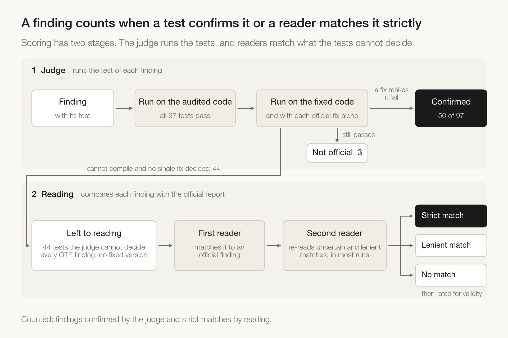

*Figure 3. The two stages of scoring. The judge classified the 97 tests written by the approaches: 50 confirmed, 3 shown not to be official findings and 44 it could not decide. Those 44 and every GTE finding were matched by reading, with a second reading of uncertain and lenient matches in most runs. Findings with no match were then rated for validity (section 5.8). A test that cannot compile against the fixed code is run with each official fix applied alone, which is how all 7 Promis confirmations were made.*

The judge runs the approach's test on a fresh copy of the audited code and on a fresh copy of the fixed code. Each official fix is also applied on its own, to link a test to one official finding. When a fix does not apply cleanly on its own, the test is run just before and at the commit of that fix.

| On the audited code | On the fixed code | With each official fix applied alone | Result |
|---|---|---|---|
| Test passes | Test fails | Used to name the official finding | Confirmed |
| Test passes | Test passes | Not needed | Not one of the official findings, or the test proves nothing |
| Test passes | Test cannot compile or set up | One fix makes the test fail | Confirmed |
| Test passes | Test cannot compile or set up | No single fix makes the test fail | Needs reading |
| Test does not pass | Not run | Not run | Not demonstrated |

All 97 judged tests pass on the audited code.

| Project | Reports judged | Confirmed | Shown not to be official | Left to reading |
|---|---|---|---|---|
| ONCHAINID | 77 | 43: 31 against the fixed version, 12 by one official fix (7 with the fix applied alone and 5 at the commit of the fix) | 3 | 31 |
| Promis | 20 | 7, all by one fix applied alone | 0 | 13 |
| GTE | None. No fixed version is public | 0 | 0 | All |

In the 44 cases left to reading, the test did not compile against the fixed code. On Promis no test compiled against the final fixed version.

Two ONCHAINID Highs share one fix, so the judge cannot tell them apart. They were split by reading.

### 4.3 Matching by reading

When the judge cannot decide, a reader compares the reported finding with the official report. Each reading is made by the model in a separate session.

| Match | Condition |
|---|---|
| Strict | The official root cause is the subject of the finding, and its test demonstrates it |
| Lenient | The root cause is mentioned in passing, or the scenario is reproduced under a different cause |
| None | Same area, different root cause |

The numbers in this report are strict matches unless stated otherwise.

| Runs | First reading | Second reading |
|---|---|---|
| ONCHAINID, run 1 | By title, recorded as "by hand" | Reader |
| ONCHAINID, runs 2 and 3 | Reader | Reader |
| GTE, first round | Reader per approach, differences then settled "by hand" | Reader |
| GTE, second round | Reader | Reader |
| GTE, second round repeated | Reader | None |
| Promis | Reader | None |

| Second reading | Result |
|---|---|
| What it re-decided | Uncertain matches, lenient matches and a sample of 21 confident ones |
| Verdicts changed | 14 |
| Strict matches added | 1 |
| Strict matches removed | 0 |

The files do not record whether the readings marked "by hand" were made by a person or by a model.

### 4.4 What is measured

The metrics follow those of Anthropic's security evaluations where an equivalent exists.

**Results**

| Metric | Definition | Follows |
|---|---|---|
| Official findings found | Reported findings that match an official one, by severity | "Targets exploited", Anthropic smart-contract evaluation |
| Found in k of 3 runs | How many of the three ONCHAINID runs find each official finding | Best of N runs, same source |
| Findings outside the report | Reported findings with no official match that a reader rated valid | Previously unknown vulnerabilities, same source |
| Questions decided and open | Questions closed by a test, closed by a written argument, and left open. Approach C | Own metric |

**Quality**

| Metric | Definition | Follows |
|---|---|---|
| Precision | Distinct valid findings divided by distinct reported findings | Heimdallr, AIxCC scoring |
| Severity agreement | Reported severity compared with the official one | Anthropic's Mythos Preview assessment |

**Effort**

| Metric | Definition | Follows |
|---|---|---|
| Minutes per run | Wall-clock time of the session. Main effort measure | A1, Heimdallr |
| Minutes per valid finding | Minutes divided by distinct valid findings | Own metric |
| Output tokens per valid finding | Tokens written by the model, sub-agents included, divided by distinct valid findings | Tokens per successful exploit, Anthropic smart-contract evaluation |
| Output tokens of a run | Tokens written by the main session and its sub-agents | Same source |

### 4.5 Counting rules

- **Comparable basis.** Official Critical, High and Medium findings. Counts that include Low findings or Notes are shown separately and are not comparable with approach A.
- **Reported.** The number of findings an approach reports.
- **Distinct.** A finding that repeats a root cause the same approach already reported is counted once.
- **Valid.** A finding that matches an official one, strictly or leniently, or that a reader rated valid (section 5.8).
- **Doubtful.** A reported finding that a reader could not rate valid or invalid.
- **Time.** For a run that was interrupted and resumed, the minutes of both sessions are added.

## 5. Experiments

Each experiment is reported in the same order: the question it answers, the method, the results, a reading of them and a one-line conclusion.

| Experiment | What it measures | Project | Test of the study design | Question |
|---|---|---|---|---|
| [1](#sec-5-1) | Findings found across three independent runs | ONCHAINID | 1 | Is the difference between approaches stable from run to run? |
| [2](#sec-5-2) | Findings found on a larger project | GTE | 2, first round | Do the differences hold on a larger project? |
| [3](#sec-5-3) | What the model recalls of a public report | GTE | 2, control | Does the model remember the findings of a report it may have seen? |
| [4](#sec-5-4) | The step where Hypatia lost each official finding it missed | GTE | 2, first round | Why did Hypatia with code map miss 20 official findings? |
| [5](#sec-5-5) | New findings when an audit is continued | GTE | 2, second round | What does each approach find when asked to continue? |
| [6](#sec-5-6) | The second round after correcting Hypatia | GTE | 2, second round repeated | Does the second round improve once the losses are corrected? |
| [7](#sec-5-7) | Findings found on a project the model had not seen | Promis | 3 | Do the differences hold on a project the model had not seen? |
| [8](#sec-5-8) | Validity of findings outside the official reports | All three | 1, 2 and 3 | Are the reported findings with no official match valid? |
| [9](#sec-5-9) | Time and tokens per valid finding | All three | 1, 2 and 3 | How much time and how many tokens does a finding take? |

### 5.1 Experiment 1: findings found across three independent runs

**Question.** Is the difference between approaches stable, or does it depend on the run?

**Method.** Three independent repetitions of the three approaches on ONCHAINID, with the first version of Hypatia. Each starts from a fresh workspace, and no session referred to another run.

Of the 77 reports, 43 were confirmed by the judge, 3 were shown not to be official findings and 31 were matched by reading.

**Results.** Main result, on the comparable basis of 12 official Critical, High and Medium findings:

| Approach | Critical, High, Medium per run | Mean | Distinct over 3 runs | In 3 of 3 |
|---|---|---|---|---|
| A | 3, 3, 4 | 3.3 | 4 | 3 |
| B | 4, 6, 5 | 5.0 | 6 | 3 |
| C | 5, 4, 6 | 5.0 | 6 | 4 |

All severities, out of 39. Row A is not comparable with B and C (section 4.5).

| Approach | All severities per run | Mean | Distinct over 3 runs | In 3 of 3 | Reported per run | Minutes per run |
|---|---|---|---|---|---|---|
| A | 4, 4, 5 | 4.3 | 6 | 3 | 4, 5, 6 | 10.8, 13.8, 9.9 |
| B | 7, 9, 8 | 8.0 | 11 | 4 | 8, 10, 9 | 22.8, 31.4, 22.1 |
| C | 13, 8, 11 | 10.7 | 15 | 7 | 15, 8, 12 | 47.5, 35.4, 54.2 |

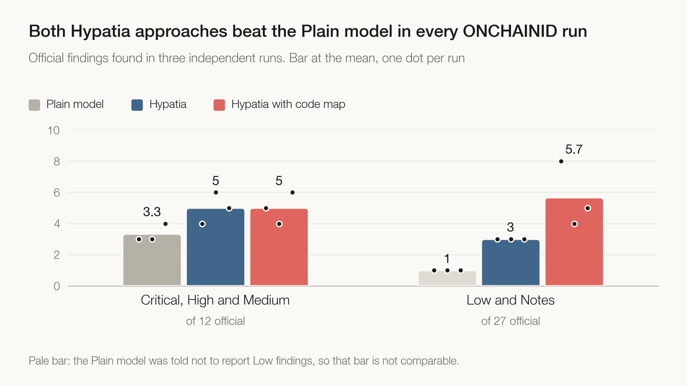

*Figure 4. Official findings found by each approach on ONCHAINID, with the bar at the mean of three independent runs and one dot per run. The pale bar of the Plain model in the right group is not comparable.*

**Reading.** The code map shows no gain on the comparable basis: B and C have the same mean and find the same six distinct findings.

Between B and C, the code map approach matches more Low findings and Notes (mean 5.7 against 3.0). The four distinct findings C has and B lacks are three Lows and one Note. Three runs are too few to call this difference stable.

The order of B and C changed between runs: C was ahead in run 1 and behind in run 2, on both bases.

The Critical finding and five of the nine Mediums are found by no approach in any run. Both Highs are found by each approach in each run.

**Conclusion.** On ONCHAINID both Hypatia approaches find more Critical, High and Medium findings than the Plain model in three runs out of three, and the code map adds none on that basis.

### 5.2 Experiment 2: findings found on a larger project

**Question.** Do the differences hold on a larger project with more High and Medium findings?

**Method.** One run of the three approaches on GTE, with the first version of Hypatia. No fixed version exists, so all matches were made by reading.

**Results.**

| Approach | High of 10 | Medium of 25 | Strict total | Lenient total | Reported | Distinct reported | Distinct valid | Precision | Minutes |
|---|---|---|---|---|---|---|---|---|---|
| A | 6 | 2 | 8 | 10 | 16 | 16 | 14 | 0.88 | 84.6 |
| B | 5 | 5 | 10 | 14 | 19 | 19 | 18 | 0.95 | 48.1 |
| C | 7 | 8 | 15 | 19 | 35 | 34 | 30 | 0.88 | 76.3 |

Across the three approaches: 8 of 10 Highs and 8 of 25 Mediums.

A reader rated the reports not counted as valid as doubtful, and none as invalid.

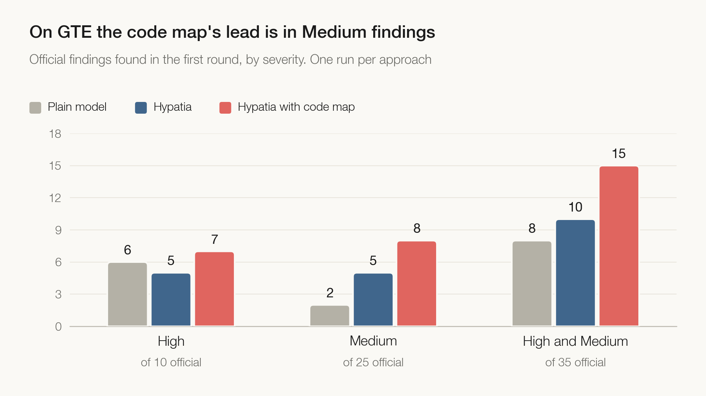

*Figure 5. High and Medium official findings matched strictly by each approach in the first round on GTE, by severity and in total. One run per approach.*

**Reading.** Highs are close across approaches, and the difference is in Mediums.

Reported and valid counts include Low findings and are not comparable with A. Approach C's valid findings include seven Lows outside the report that were not re-checked (section 5.8).

All three approaches often give a severity different from the official one. Several official Highs are reported as Medium, and several Mediums as Low or High.

**Conclusion.** On GTE the code map approach matched 15 official findings against 10 and 8, in one run on a project whose report the model may have seen.

### 5.3 Experiment 3: what the model recalls of a public report

**Question.** Does the model remember the findings of GTE's report, which was public before its knowledge cutoff?

**Method.** The model was asked three times to list the report's High and Medium findings from memory and told not to guess. The prompt states that it has no tools and no code.

The scoring record states the same model and effort with no tools, and the stored answers show one turn each. The command line was not stored, so effort and the absence of tools cannot be checked.

No probe was run for ONCHAINID or Promis.

**Results.** Each of the three attempts recalled 0 of 35 findings. The model recalled only the general design of the protocol.

**Reading.** The model did not recite the report. The probe does not rule out weaker familiarity.

Having seen the code or the write-ups during training may still help the model recognise a bug once it reads the code.

**Conclusion.** No recall was found, and GTE is still treated as a project the model may have seen.

### 5.4 Experiment 4: the step where Hypatia lost each official finding it missed

**Question.** Hypatia with code map found 15 of the 35 official findings of GTE. Why did it miss the other 20?

**Method.** The 20 missed findings are real vulnerabilities of the official report. Each was traced through the first round's records: the function records, the question list, the rejections and the reports. The tracing was done by a reader.

Each finding is assigned to the step of the audit where it was lost. "Wrongly rejected" means that Hypatia asked a question that covered the finding and closed it as not a vulnerability.

**Results.**

| Lost at | Findings |
|---|---|
| The affected function was not in the code map | 0 |
| A question was asked and wrongly rejected | 8 |
| No question on the mechanism | 7 |
| Seen, but folded into another finding or downgraded | 4 |
| The question was left open | 1 |

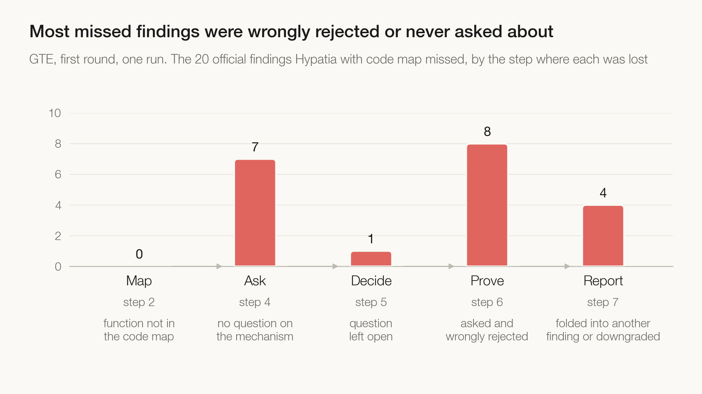

*Figure 6. The 20 official findings Hypatia with code map missed in the first round on GTE, by the step of Figure 2 where each was lost, in the order of the audit. One run, traced by a reader.*

**Reading.** The first-round question list had 451 questions, 246 of them rejected. The rejections had been closed in 13 batches of up to 42 questions, with one line of reasoning per question and one internal reviewer of Hypatia per batch. One rejected question described an official finding exactly and was dismissed with "only its length is used".

The seven with no question needed lifecycle changes, call sequences or extreme values. The question list had call-pair questions for the launchpad contracts and one vault, not for the perpetuals contracts. The cause was technical: a class of state writes was not turned into call-pair questions.

**Conclusion.** In the first round on GTE the largest loss was wrong rejection (8 of 20), followed by missing questions (7 of 20).

### 5.5 Experiment 5: new findings when an audit is continued

**Question.** When each approach is asked to continue its own audit, what does it find?

**Method.** A second round on GTE in the same workspace as the first, with the first version of Hypatia. All three approaches receive the same sentence about not repeating known findings.

- **B and C** use Hypatia's documented follow-up procedure. It includes an operator step: the draft profile of the next round is reviewed and approved before launch.
- **A** gets its original prompt plus a section pointing at its own first-round output. It has no operator step.

All matches were made by reading.

**Results.**

| Approach | Reported | Distinct new findings | New official, strict | Other new, rated valid | Doubtful | Minutes | After two rounds, strict |
|---|---|---|---|---|---|---|---|
| A | 2 | 2 | 0 | 2 | 0 | 21.3 | High 6, Medium 2 |
| B | 2 | 2 | 0 | 2 | 0 | 19.0 | High 5, Medium 5 |
| C | 15 | 13 | 2 | 7 | 4 | 79.1 | High 8, Medium 9 |

Of approach C's 15 reports, one repeats another of the same round and one repeats a root cause of its first round.

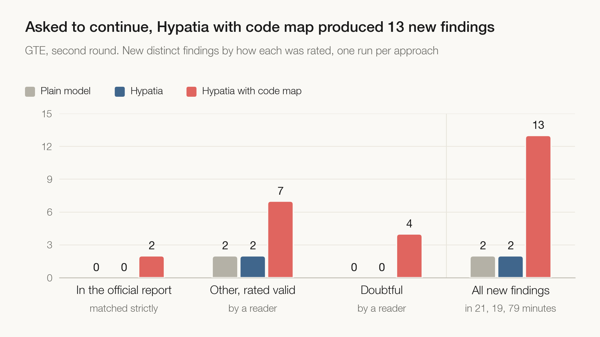

*Figure 7. Distinct new findings of each approach in the second round on GTE, by how each was rated: matched strictly to the official report, rated valid by a reader, or doubtful. The last group is the total, with the minutes of each run. One run per approach.*

**Reading.** A reader rated the two new findings of A as Medium, and those of B as one High and one Low. The two of B had already been found by C in the first round.

Approach C rebuilt its question list: 253 questions, 194 of them derived from the code map. Its two new official findings are cases the loss analysis had classed as "no question on the mechanism".

While preparing this round, a gap was found in Hypatia. This round received the list of known findings but not the question list. It rebuilt its questions without knowing which had been answered, and the 82 questions left undecided in the first round were not passed on.

Approach C wrote 1.34 million output tokens against 0.12 and 0.10 million. Another job was running on the machine during this round, so its wall time is not comparable with other rounds.

**Conclusion.** In the one second round run, on GTE, Hypatia with code map produced 13 distinct new findings, two of them official, and the other two approaches produced 2 each, none official.

### 5.6 Experiment 6: the second round after correcting Hypatia

**Question.** If the losses of section 5.4 are corrected, does the second round improve?

**Method.** Four corrections were made as one group, each tied to a measured loss.

| Correction | Loss it answers |
|---|---|
| A rejection needs its own passing test per question. "Intended", "harmless" and "not profitable" need an internal reviewer of Hypatia on that question | 8 wrongly rejected |
| Call-pair questions also cover the class of state writes that had been skipped. One question added about state that existed before the first call of a pair | 7 with no question |
| A report lists other root causes it mentions, and each is decided on its own | 4 folded into other findings |
| No closing with undecided questions while iterations remain. The next round inherits the question list | 1 left open, 82 undecided |

The same version also closes an audit by itself at the iteration limit. Three of the four corrections act on the question list, which exists with the code map. The third correction, on reports, applies to B as well.

No new rules were added for extreme-value and lifecycle questions. They existed but were not asked on the perpetuals contracts, which had no call pairs (section 5.4). The correction raised the call pairs from 127 to 676.

An independent check of the first changes found that an undecided question could be closed without an internal reviewer through another status. This applied to 671 of 676 call pairs and was fixed before the run.

The second round was then repeated for B and C from the saved first-round state, with an iteration limit of 40. The C run was interrupted by a network failure at iteration 33 and resumed. The Plain model was not repeated, since it does not use Hypatia.

All matches of the repeated round were made by one reader in one pass.

**Results.**

| Approach C, second round | Uncorrected | Corrected |
|---|---|---|
| New findings | 15 reported, 13 distinct | 17 reported, 16 distinct |
| New official, strict | H-02, M-13 | M-09, M-13, M-25 |
| New official, lenient | none | H-10 |
| Other new, rated valid | 7 | 8 |
| Doubtful | 4 | 4 |
| Questions rejected | 53, no test per question | 80, each naming its own test |
| Iterations used | 19 of 100, closed by itself (one record counts 20) | 40 of 40, closed at the iteration limit |
| Minutes | 79.1 | 105.2 |
| After two rounds, strict | High 8, Medium 9, total 17 | High 7, Medium 11, total 18 |
| After two rounds, lenient | 21 | 23 |

The report of the corrected round that is not counted as distinct repeats an official Medium that approach C had found in its first round. The lenient match to H-10 has medium to low confidence, and without it the lenient total is 22.

Approach B gave the same two findings in both versions.

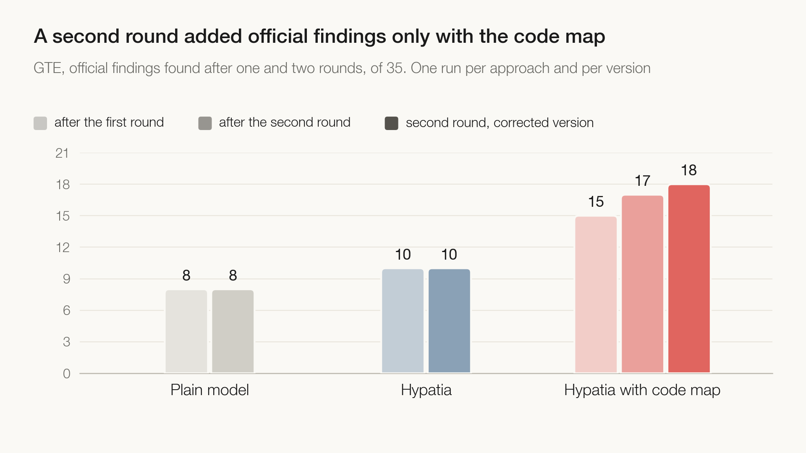

*Figure 8. Official findings of GTE matched strictly after the first round and after the second, out of 35, for each approach and for the corrected version of Hypatia with code map. One run per approach and version, on the project Hypatia was corrected on, and the corrected run also used twice as many iterations.*

What happened in the corrected round to the 20 findings missed in the first round:

| Outcome in the corrected round | Findings |
|---|---|
| Found | 4: M-09, M-13 and M-25 strictly, H-10 leniently |
| A question was asked and rejected | 8, six of which had also been rejected in the first round |
| Closed by a written argument or left unanswered | 3 |
| No question on the mechanism | 3 |
| Unchanged, kept inside another finding | 2 |

Question list of the corrected round, 804 questions:

| Status | Questions |
|---|---|
| Inherited from the first round as decided | 63 |
| Decided by a test in this round | 86 |
| Closed by a written argument, marked "not refuted" | 649 |
| Pending review | 6 |

Of the 17 reports of the corrected round, 11 did not come from a question of the list. They came from additional search passes and from Hypatia's internal reviewers.

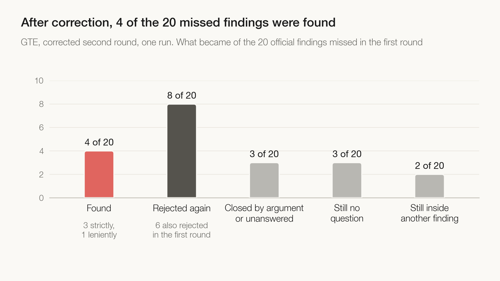

*Figure 9. Outcome, in the corrected second round, of the 20 official findings Hypatia with code map missed in the first round on GTE. Of the four found, three are strict matches and one is lenient. One run per version.*

**Reading.** M-09 had been rejected in the first round because the attack loses money, and is now found. Most of the 80 tests named by rejections are first-round tests run again.

Wrong rejection was not removed. Of the eight findings rejected, four had a new test per question and four cited a first-round test. In one case the rejection states the defect and then accepts it. A reader of the run concluded that those tests checked the mechanism and not the harm.

The 649 questions marked "not refuted" share 488 distinct conclusions. Their reasoning combines a sentence specific to the question with repeated templates.

**Conclusion.** The corrected round moved the result from 17 to 18 official findings, lost H-02 and did not remove wrong rejection, and one run per version cannot separate the corrections from running twice as many iterations.

### 5.7 Experiment 7: findings found on a project the model had not seen

**Question.** Do the differences hold on a project whose report the model could not have seen and on which Hypatia was not corrected?

**Method.** One run of the three approaches on Promis, with the corrected version of Hypatia and an iteration limit of 40. The reference is the 9 official High and Medium findings inside the audited files. The judge confirmed 7 of the 20 reports, all matches to one Medium and two Lows. One reader matched the other 13 in one reading, and every High match is among them. The C run stalled in its first iteration because of a defect of Hypatia and was resumed.

**Results.**

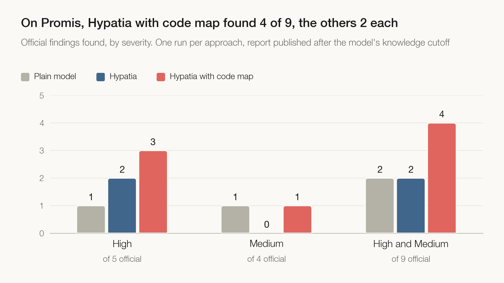

*Figure 10. Official High and Medium findings of Promis found by each approach, by severity and in total. One run per approach, and the Mediums are the four inside the audited files.*

Finding by finding, with the step where approach C lost each one it missed:

| Finding | A | B | C | Where approach C lost it |
|---|---|---|---|---|
| H-01 | – | – | – | No question on the mechanism |
| H-02 | – | – | Found | |
| H-03 | – | – | – | A question existed and was not reached before the iteration limit |
| H-04 | – | Found | Found | |
| H-05 | Found | Found | Found | |
| M-01 | – | – | – | No question was generated, although the function records stated the mechanism |
| M-02 | – | – | – | No question on the mechanism |
| M-03 | Found | – | Found | |
| M-05 | – | – | – | Partly outside the audited files. No question on the part inside them |
| **Found of 9** | **2** | **2** | **4** | |
| Minutes | 11.1 | 23.6 | 88.8 | |

Other counts, which include Low findings and are not comparable with A (section 4.5):

| Approach | Distinct reports | Low of 14 | Rated valid, outside the report | Precision |
|---|---|---|---|---|
| A | 3 | 1 | 0 | 3 of 3 |
| B | 5 | 1 | 2 | 5 of 5 |
| C | 10, in 12 reports | 3 | 3 | 10 of 10 |

**Reading.**

- **Detection.** The code map approach covers the High and Medium findings the other two found and adds one High. Five of the nine are found by no approach.
- **Misses.** None of approach C's misses was a rejection. Its question list had 463 questions and 17 were decided before the iteration limit, 3.7 percent. Five of its 12 reports came from outside the list.
- **Severity.** The reported severity agrees with the official one in 2 of 3 matched reports for A, 0 of 3 for B and 2 of 9 for C.
- **Judgement calls.** The match to H-05 would be lenient for all three approaches under a stricter reading, which gives 1, 1 and 3 of 9. One finding of B outside the report was rejected by C as intended behaviour, and if it is doubtful B has 4 valid of 5.
- **One run.** It cannot show whether approach C's result comes from the code map or from the longer run.

**Conclusion.** On Promis, in one run, Hypatia with code map found 4 of 9 High and Medium findings against 2 for each of the other approaches, and ran 3.8 to 8.0 times as long.

### 5.8 Experiment 8: validity of findings outside the official reports

**Question.** Do the approaches find valid vulnerabilities that the official reports do not contain?

**Method.** Validity was rated by readers. No auditor has confirmed any of these findings. Findings claimed High or Medium in the first and second round on GTE and the three ONCHAINID findings still present in the fixed version were checked by a second reader against the code. The others were rated once. Findings that are not in a public report are described by class.

**Results.**

| Project | Rated valid, outside the report | Highest rating | Reported by | Still in the fixed version |
|---|---|---|---|---|
| ONCHAINID | 4 | Medium | A, B, C | 3 yes. 1 fixed later by the project |
| GTE, first and second round | 11 checked twice: 1 High, 6 Medium, 2 Low to Medium, 2 Low | High | A, B, C | No fixed version |
| GTE, second round repeated | 8, and 4 doubtful | Rated once | C | No fixed version |
| Promis | 4, in five reports | Low or Informational | B, C | Yes |

The rows overlap: several findings of the repeated round are the same issues as earlier rows. Also on GTE: 15 further findings claimed Low by B and C were counted valid on one rating, and two findings on how liquidation is priced could not be told apart from intended behaviour.

**Reading.**

- **One finding has support beyond a rating.** On ONCHAINID, the scoring file records a later commit by the project whose message describes the same defect. The match was made by reading, and whether that commit is public and merged is not recorded.
- **Agreement between approaches is weak support.** Several findings are reported by more than one approach, and the approaches share one model.
- **GTE findings are not shown to be new.** The contest's lower-severity reports are not in the reference (section 3.3).
- **Disclosure.** According to the owner, none of these findings has been disclosed to any project. No file records the disclosure status. Disclosure is a decision for the owner and must come before any publication of details.

**Conclusion.** All three approaches report findings beyond the official reports that readers rated valid, and their validity needs an auditor's confirmation.

### 5.9 Experiment 9: time and tokens per valid finding

**Question.** How much time and how many tokens does a run and a valid finding take in each approach?

**Method.** The runs use a flat-rate subscription and one model for the audit work, so effort is reported as time and tokens and not as price. Minutes, tokens and valid findings follow sections 4.4 and 4.5. Tokens are read from the cumulative usage in the final result record of each session transcript.

Valid findings include Low findings and findings outside the reports.

The column of official Critical, High and Medium findings gives the comparable basis. In second rounds it counts new ones.

**Results.**

| Project, run | Approach | Run time, minutes | Output tokens of the run | Distinct valid findings | Of them, official Critical, High, Medium | Minutes per valid finding | Output tokens per valid finding |
|---|---|---|---|---|---|---|---|
| ONCHAINID, run 1 | A | 10.8 | 62,870 | 4 | 3 | 2.7 | 15,718 |
| ONCHAINID, run 1 | B | 22.8 | 119,424 | 8 | 4 | 2.9 | 14,928 |
| ONCHAINID, run 1 | C | 47.5 | 530,501 | 15 | 5 | 3.2 | 35,367 |
| ONCHAINID, run 2 | A | 13.8 | 78,046 | 5 | 3 | 2.8 | 15,609 |
| ONCHAINID, run 2 | B | 31.4 | 161,413 | 10 | 6 | 3.1 | 16,141 |
| ONCHAINID, run 2 | C | 35.4 | 181,912 | 8 | 4 | 4.4 | 22,739 |
| ONCHAINID, run 3 | A | 9.9 | 54,435 | 6 | 4 | 1.7 | 9,072 |
| ONCHAINID, run 3 | B | 22.1 | 118,433 | 9 | 5 | 2.5 | 13,159 |
| ONCHAINID, run 3 | C | 54.2 | 554,818 | 12 | 6 | 4.5 | 46,235 |
| GTE, round 1 | A | 84.6 | 469,663 | 14 | 8 | 6.0 | 33,547 |
| GTE, round 1 | B | 48.1 | 522,121 | 18 | 10 | 2.7 | 29,007 |
| GTE, round 1 | C | 76.3 | 1,897,842 | 30 | 15 | 2.5 | 63,261 |
| GTE, round 2 | A | 21.3 | 120,715 | 2 | 0 | 10.7 | 60,358 |
| GTE, round 2 | B | 19.0 | 101,893 | 2 | 0 | 9.5 | 50,946 |
| GTE, round 2 | C | 79.1 | 1,343,094 | 9 | 2 | 8.8 | 149,233 |
| GTE, round 2 corrected | B | 22.8 | 117,806 | 2 | 0 | 11.4 | 58,903 |
| GTE, round 2 corrected | C | 105.2 | 1,347,292 | 12 | 3 | 8.8 | 112,274 |
| Promis | A | 11.1 | 65,349 | 3 | 2 | 3.7 | 21,783 |
| Promis | B | 23.6 | 120,715 | 5 | 2 | 4.7 | 24,143 |
| Promis | C | 88.8 | 626,898 | 10 | 4 | 8.9 | 62,690 |

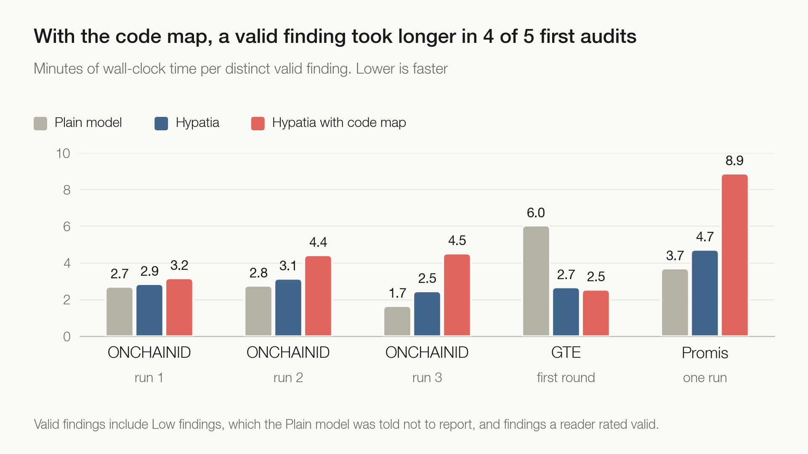

*Figure 11. Wall-clock minutes per distinct valid finding in the five first audits, the three ONCHAINID runs, the first round on GTE and the Promis run. Second rounds are in the table above.*

The first two numeric columns describe the whole run and the last two divide it by the valid findings. Tokens count the main session and every sub-agent it launched. Input tokens are not counted. Time and tokens do not always move together: in GTE round 1 approach A ran longer than C and wrote about a quarter of its output tokens.

**Reading.**

- **Whole audit.** In first audits approach C took 0.9 to 8.0 times the minutes of approach A and 2.3 to 10.2 times its output tokens. Approach B took 0.6 to 2.3 times the minutes and 1.1 to 2.2 times the output tokens.
- **Per valid finding.** Approach C takes more minutes than A in four of five first audits, and B takes up to 1.0 minute more than A in those four. GTE round 1 is the exception: approach A's 84.6 minutes include 58 in which its main session waited for five sub-agents it had launched, whose tokens are counted.
- **Per official Critical, High and Medium finding.** The ordering between A and C is the same, with GTE again the exception. On ONCHAINID run 1, C takes 9.5 minutes per such finding against 3.6 for A. On GTE it takes 5.1 against 10.6.
- **Second rounds.** Approach C takes the fewest minutes per valid finding. Each approach takes more minutes per finding in its second round than in its first.
- **Tokens.** Approach C uses the most output tokens per valid finding in each of the seven groups of the table.
- **Caveats.** Of approach C's 88.8 minutes on Promis, the first 26.5, 30 percent of the total, ended with no finding and include the stall caused by a defect of Hypatia. Some runs shared the machine with other jobs, which affects minutes and not tokens.

**Conclusion.** Hypatia with code map uses 2.3 to 10.2 times the output tokens of the Plain model per first audit, takes more minutes per valid finding in four of five first audits and uses the most output tokens per valid finding in each group.

## 6. Synthesis

The experiments give six results. Each is developed in the section named in brackets.

1. **Detection.** Hypatia with code map finds at least as many official Critical, High and Medium findings as the other two approaches on each project, on ONCHAINID in the mean of three runs, and more on GTE and Promis (5.2, 5.7).
2. **Small project.** On ONCHAINID, Hypatia finds the same six Critical, High and Medium findings with and without the code map (5.1).
3. **Continuation.** Asked to continue on GTE, Hypatia with code map produced 13 new findings against 2 for each of the others (5.5).
4. **Rejection.** On GTE, 8 of the 20 official findings Hypatia with code map missed had been asked about and rejected. Four corrections recovered one strictly and one leniently (5.4, 5.6).
5. **Questions decided.** A test decided 86 of 804 questions on GTE and 17 of 463 on Promis (5.6, 5.7).
6. **Effort.** A first audit with the code map took 0.9 to 8.0 times the time of the Plain model and more tokens per valid finding in every case (5.9).

### 6.1 Results by approach

Findings are official Critical, High and Medium findings, the basis on which the three approaches are comparable. Low findings and Notes are in sections 5.1 and 5.7.

| Measure | A, Plain model | B, Hypatia | C, Hypatia with code map | Section |
|---|---|---|---|---|
| ONCHAINID, found of 12, mean of three runs | 3.3 | 5.0 | 5.0 | 5.1 |
| GTE, found of 35, one run | 8 | 10 | 15 | 5.2 |
| Promis, found of 9 inside the audited files, one run | 2 | 2 | 4 | 5.7 |
| GTE, new findings when asked to continue | 2 | 2 | 13 | 5.5 |
| Of them, in the official report | 0 | 0 | 2 | 5.5 |
| GTE, new findings with the corrected version | Not run | 2 | 16, of which 3 official strictly and 1 leniently | 5.6 |
| Precision, first rounds | 0.88 to 1.00 | 0.95 to 1.00 | 0.88 to 1.00 | 5.1, 5.2, 5.7 |
| Precision, second rounds | 2 of 2 | 2 of 2, twice | 0.69 and 0.75 | 5.5, 5.6 |
| Duration of a run, minutes | 10 to 85 | 19 to 48 | 35 to 105 | 5.9 |
| Output tokens of a run, thousands | 54 to 470 | 102 to 522 | 182 to 1,898 | 5.9 |
| Keeps a list of questions with their status | No | No | Yes | 3.4 |

### 6.2 Contribution of Hypatia and of the code map

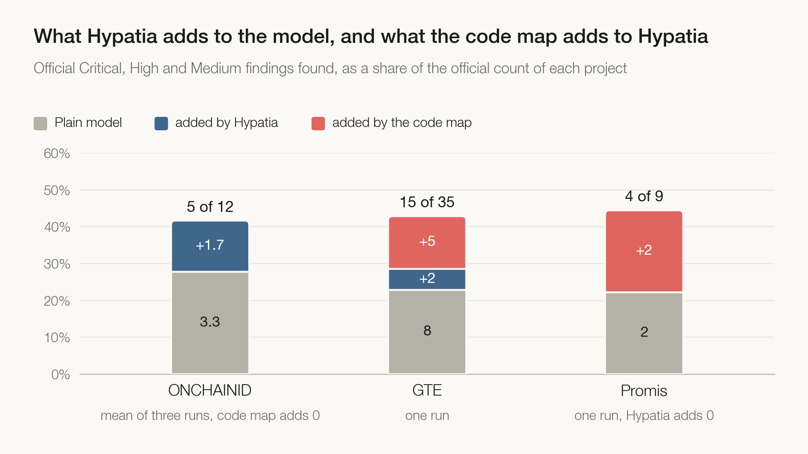

*Figure 12. Official Critical, High and Medium findings found by the Plain model, and the count added by Hypatia and then by the code map, as a share of the official count of each project. The segments are differences between counts, not sets of the same findings. ONCHAINID is the mean of three runs, GTE and Promis rest on one run per approach.*

- **The Plain model.** It finds both ONCHAINID Highs in each run and six of ten GTE Highs in a run of 85 minutes. It writes tests, and no report of it was rated invalid by a reader. It gives no list of what it did not examine. On Promis it listed ideas it had examined and dropped, one of them an official High.
- **Hypatia over the Plain model.** The gain appears on ONCHAINID and GTE and not on Promis.
- **The code map over Hypatia.** The gain appears on the two larger projects and not on ONCHAINID. On GTE most of it is in Mediums. On Promis it is one High and one Medium.
- **Continuation.** Approach B has Hypatia's phases and a code-graph search tool. In the one second round it produced two new findings, as the Plain model did. The second-round result comes from one run on GTE (section 5.5).

### 6.3 The question list

Hypatia with code map ends an audit with the list of its questions, in priority order, and the status of each. In the corrected version a later round starts from that list, which was exercised once.

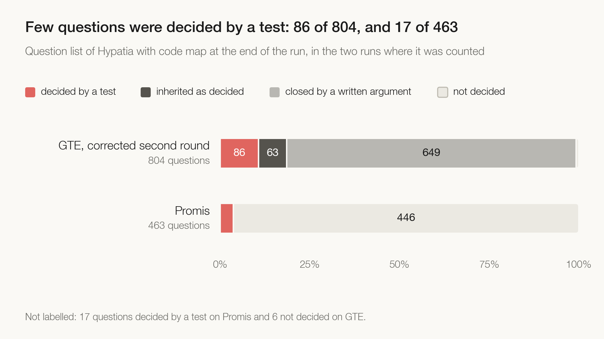

*Figure 13. Status of the question list of Hypatia with code map at the end of the corrected second round on GTE and of the Promis run, one run each.*

- **It locates part of what was missed.** On GTE, 9 of the 20 findings missed in the first round sat in questions that were left open or wrongly rejected. On Promis, one of the two Highs approach C missed sat in a question that was not reached before the iteration limit.
- **Most of it stays open.** On Promis 446 of 463 questions were undecided at the end, 445 open and 1 candidate. An open question is a place to look and is not evidence of a bug.
- **Part of the findings come from outside it.** 5 of 12 reports on Promis and 11 of 17 in the corrected GTE round.
- **It requires a code map.** The list is derived from the functions, their calls and the state they touch. The code map tool used here analyses Solidity.

## 7. Limitations

- **Scoring was done by tests and by reading.** A second reader changed 14 verdicts and overturned no strict match.
- **Validity and severity are model ratings.** Findings outside the official reports are unconfirmed, and all approaches often disagree with the official severity.
- **The approaches had different instructions.** Approach A was told to report Medium severity or higher, so counts with Low findings are not comparable with it. B also differs from A in code-graph search and in details of the prompt, so the comparison of B with A does not isolate Hypatia.
- **Few runs.** ONCHAINID has three repetitions, and there the order of B and C changed between runs. GTE and Promis have one run per approach.
- **Unequal effort.** Approach C runs longest in most runs. The Plain model was not tested with the same total time spread over several independent runs.
- **GTE is the development project.** Its report was public before the model's knowledge cutoff, and the corrections of section 5.6 were designed from its official answers. The corrected run also used twice the iterations, so the two effects cannot be separated.
- **Versions and procedure differ across runs.** ONCHAINID and the first two GTE rounds used the first version of Hypatia, and Promis the corrected one. In the second round an operator prepared and approved the profile for B and C, and not for A.
- **Execution.** Two runs of approach C were interrupted and resumed, and their time is the sum of both sessions. Some runs shared the machine with other jobs. Isolation was checked by scanning the commands of every counted session, not by a file-system trace.
- **The code map has blind spots.** It reports truncated paths, did not record a class of state writes, and failed on one candidate project.
- **Checks not done or not recorded.** The planned run of the judge on a planted bug and the human reading of a sample of its verdicts. Whether the network block covers sub-agents. The command line of the memory probe. Any use of the three projects while Hypatia was developed, beyond a discarded ONCHAINID trial on 16 November.

## 8. Conclusion

The study asked whether Hypatia with a code map finds more of the vulnerabilities that professional audits reported than the model alone, and whether it lets an audit continue from where it stopped. On three projects the answers are these.

**Detection**

- **It finds more on the two larger projects.** Hypatia with code map found 15 of 35 official findings on GTE against 8 for the model alone, and 4 of 9 on Promis against 2.
- **On those projects the gain appears with the code map.** Hypatia without it found 10 on GTE and 2 on Promis, the same as the model alone on Promis. Hypatia's structured phases alone do not account for the gain.
- **On the smallest project Hypatia finds more than the model alone, and the code map adds nothing.** On ONCHAINID, Hypatia found 5.0 of 12 with and without the code map, against 3.3 for the model alone.
- **The gain from the code map may grow with project size.** It added no finding on the project of 2,058 lines, 2 on the project of 3,921 lines and 5 on the project of 5,260 lines. Three projects, which also differ in Hypatia version and in number of runs, are too few to establish this. It is the hypothesis to test next.
- **Some official findings are found by no approach.** 6 of 12 on ONCHAINID, including its Critical finding, 19 of 35 on GTE in the first round and 5 of 9 on Promis.

**Repetition and continuation**

- **The advantage repeats and the findings vary.** In three independent runs on ONCHAINID, both Hypatia approaches found more than the model alone every time. The two Hypatia approaches found a different subset in each run: 4 to 6 findings per run and six distinct findings over the three. Repetition was measured on the smallest project only.
- **It continues an audit, and continuing adds depth.** Asked to continue on GTE, Hypatia with code map produced 13 new findings, two of them official, and went from 15 to 17 of 35. Each of the other two approaches produced 2, none official.

**Limits of the tool**

- **It takes more resources.** A first audit with the code map used 2.3 to 10.2 times the output tokens of the model alone and 0.9 to 8.0 times its time.
- **Its weak point is how questions are closed.** On GTE it rejected 8 real findings it had asked about, and four corrections recovered one strictly and one leniently. A test decided 86 of 804 questions on GTE and 17 of 463 on Promis.

## 9. Reproducibility

The results of each run, the official findings matched, the reference lists, the prompt of approach A and the judge are published at [github.com/scab24/hypatia-benchmark](https://github.com/scab24/hypatia-benchmark).

Software:

| Component | Version | Role |
|---|---|---|
| Model | See section 3.1 | The same in the three approaches |
| Host program | 2.1.325 | Runs each session |
| Hypatia | 1.1.22, 1.1.24 and 1.1.25 | By the author, source not public. Guides approaches B and C. Not loaded by approach A |
| [ilold](https://github.com/scab24/ilold-evm) | 0.1.0 | Open-source path analyser for Solidity, AGPL-3.0, by the author. Builds the code map of approach C |
| Foundry | 1.9.0 | Compiles the projects and runs the tests |
| Slither | 0.11.6 | Static analyser installed on the machine |
| Python | 3.12 | Runs the harness and the judge |

Projects:

| Project | Audited commit | Fixed commit |
|---|---|---|
| ONCHAINID | d2096509 | 4fda205 |
| GTE | f43e1ee | None |
| Promis | 4cd2d43 | 63ca735 |

Hypatia version of each run:

| Version | Runs | What the version changed |
|---|---|---|
| 1.1.22, first version | ONCHAINID, three runs. GTE first and second round | Fixed a defect that ended audits after the first phase |
| 1.1.24, corrected version | GTE second round repeated. Promis approach B. Promis approach C before its interruption | Automatic closing at the iteration limit, on top of the four corrections of section 5.6. Those were released in 1.1.23, which ran only in a discarded attempt |
| 1.1.25, corrected version | Promis approach C after its resume | A speed fix for projects with many dependency files |

Stored with the benchmark:

- **Each run.** The prompt or launch text, the exact command and the full session transcript.
- **Scoring.** The judge, its per-finding results and the matching tables per project, and the second read for ONCHAINID and the first two GTE rounds.
- **Incidents.** Discarded, interrupted and resumed runs with their cause, and the launch sequence.

Hypatia's source code and internal architecture are not included.

## 10. Related work and references

| Source | What it supports here |
|---|---|
| Anthropic, smart-contracts research post and SCONE-bench (2025) | Executable success criterion, split by knowledge cutoff, best of N runs, tokens and cost per success |
| Anthropic, exploit evaluations (2026) | Stated turn and wall-clock limits per run |
| Anthropic, Mythos Preview cybersecurity assessment (2026) | Severity agreement, ranking files and working through the whole list |
| Anthropic, effective harnesses for long-running agents (2025) | A structured list of items whose status changes with an executed outcome, against "declaring victory too early" |
| Quarkslab, From AI Agents to RCE (2026) | A deterministic core that over-produces leads, ranking as an ordered search space, dropping a path after an executed test showed the guard held |
| Google, Project Naptime (2024) | Success over several independent trajectories |
| Heimdallr (arXiv 2601.17833) | Precision and false-positive rate, time per project. A verifier that does not execute code filtered out valid findings, 8 percent of them High |
| A1 (arXiv 2507.05558) | Time and tokens per experiment, results at each iteration count |
| CyberGym (arXiv 2506.02548) | Success by step under an iteration limit |
| DARPA AIxCC scoring | An accuracy multiplier |
